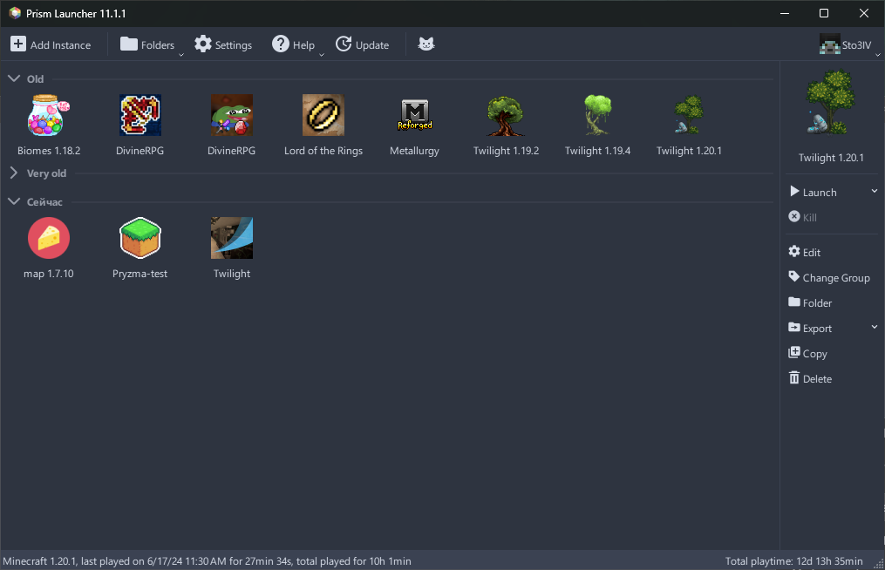
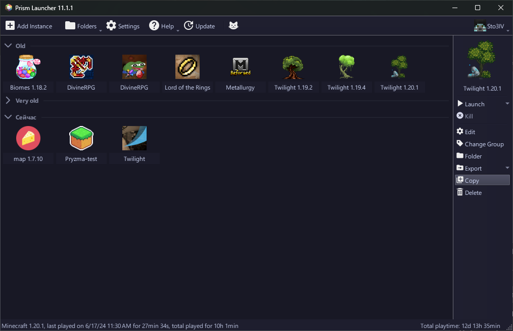
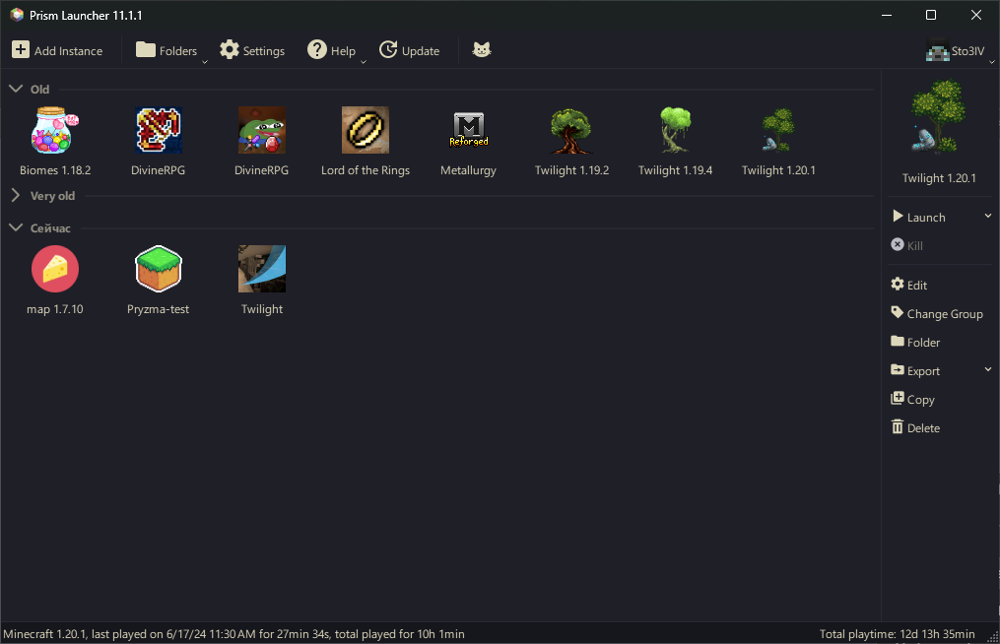
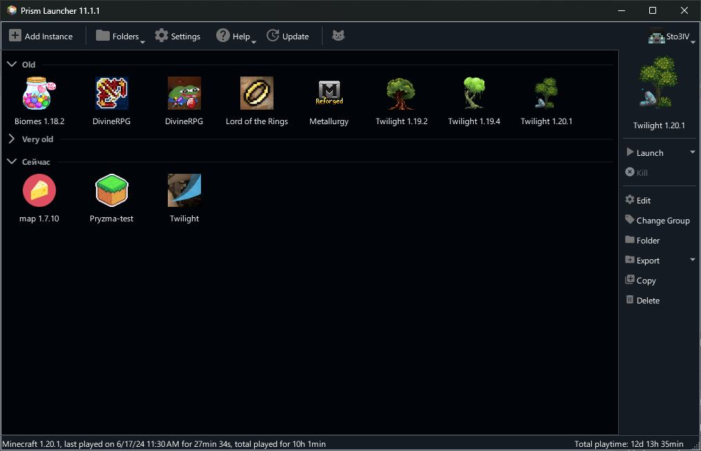
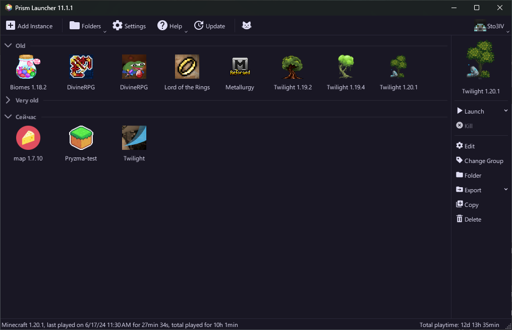

# MultiMC & Prism Launcher Themes

> *«Even in cold geometry, order breeds grace. Form and function aligned beneath a calm, lunar gaze.»*  
> — *Ranni, The Architect*

A curated collection of minimalist, aesthetic, and high-contrast dark themes meticulously calibrated for **Prism Launcher**, **MultiMC**, and compatible Qt-based Minecraft launchers.

[](https://prismlauncher.org/)
[](https://www.qt.io/)
[](#-gallery--showcase)
[](LICENSE)

---

## 🧭 Navigation

- [🎨 Gallery & Showcase](#-gallery--showcase)
  - [Nord](#nord)
  - [Rosé Pine](#rosé-pine)
  - [Kanagawa Wave](#kanagawa-wave)
  - [GitHub Dark High Contrast](#github-dark-high-contrast)
  - [Catppuccin Mocha](#catppuccin-mocha)
- [📦 Quick & Simple Installation](#-quick--simple-installation)
  - [Step 1: Open your `themes` folder](#step-1-open-your-themes-folder)
  - [Step 2: Choose your install method](#step-2-choose-your-install-method)
    - [Option A: One-command install with Git (Recommended)](#option-a-one-command-install-with-git-recommended)
    - [Option B: Manual download without Git](#option-b-manual-download-without-git)
  - [Step 3: Enable the theme in the launcher](#step-3-enable-the-theme-in-the-launcher)
- [⚙️ Technical Notes & Structure](#️-technical-notes--structure)
- [📜 License & Credits](#-license--credits)

---

## 🎨 Gallery & Showcase

### Nord
> *An arctic, north-bluish clean palette engineered for calm endurance and eye comfort.*

| Preview | Palette Specifications |
| :--- | :--- |
|  | **Name:** `Nord`<br>**Widget Style:** `Fusion`<br>**Base:** `#2E3440`<br>**Alternate Base:** `#353B49`<br>**Button / Surface:** `#434C5E`<br>**Accent / Frost:** `#88C0D0`<br>**Text / Snow:** `#D8DEE9` / `#ECEFF4`<br>**Vector Assets:** Included (`resources/`) |

---

### Rosé Pine
> *Ethereal dark velvet drenched in muted rose, iris, and pine serenity.*

| Preview | Palette Specifications |
| :--- | :--- |
|  | **Name:** `Rosé Pine`<br>**Widget Style:** `Fusion`<br>**Base:** `#191724`<br>**Alternate Base:** `#21202E`<br>**Button / Surface:** `#26233A`<br>**Highlight / Pine:** `#403D52`<br>**Link / Iris:** `#C4A7E7`<br>**Text:** `#E0DEF4`<br>**Vector Assets:** Included (`resources/`) |

---

### Kanagawa Wave
> *Inspired by the sumi ink, wave blue, and autumn tones of traditional Japanese woodblock prints.*

| Preview | Palette Specifications |
| :--- | :--- |
|  | **Name:** `Kanagawa Wave`<br>**Widget Style:** `Fusion`<br>**Base / Sumi Ink:** `#1F1F28`<br>**Alternate Base:** `#252530`<br>**Button / Surface:** `#363646`<br>**Highlight / Wave Blue:** `#2D4F67`<br>**Text / Fuji White:** `#DCD7BA`<br>**Vector Assets:** Included (`resources/`) |

---

### GitHub Dark High Contrast
> *Ultra-crisp, surgical contrast built on Primer Design primitives. Zero visual blur, maximum readability.*

| Preview | Palette Specifications |
| :--- | :--- |
|  | **Name:** `GitHub Dark High Contrast`<br>**Widget Style:** `Fusion`<br>**Base:** `#010409`<br>**Alternate Base:** `#151b23`<br>**Button / Surface:** `#262c36`<br>**Highlight:** `#504f4f`<br>**Text / Bright:** `#ffffff` / `#ff9492`<br>**Vector Assets:** Custom checkmarks & radio icons (`resources/`) |

---

### Catppuccin Mocha
> *A smooth, soothing dark pastel palette with warm lavender accents and deep charcoal base.*

| Preview | Palette Specifications |
| :--- | :--- |
|  | **Name:** `Catppuccin Mocha`<br>**Widget Style:** `Fusion`<br>**Base / Crust:** `#181825`<br>**Alternate Base / Mantle:** `#1e1e2e`<br>**Button / Surface:** `#313244`<br>**Highlight / Pink:** `#f5c2e7`<br>**Link / Lavender:** `#b4befe`<br>**Text:** `#cdd6f4` |

---

## 📦 Quick & Simple Installation

No complex setup or technical know-how required. Follow these three easy steps:

### Step 1: Open your `themes` folder

Open your launcher's `themes` folder using either way:

- **Inside the Launcher:**
  1. Open **Prism Launcher** (or **MultiMC**).
  2. Click **Settings** ➔ **User Interface**.
  3. Under the Theme section, click the **Folder icon** or open the launcher folder and go into `themes`.
- **Or via File Explorer:**
  - **Windows:** Press `Win + R`, paste `%APPDATA%\PrismLauncher\themes` and press `Enter` *(or open `themes` inside your portable launcher folder)*.
  - **Linux (Flatpak / Steam Deck):** `~/.var/app/org.prismlauncher.PrismLauncher/data/PrismLauncher/themes/`
  - **Linux (Standard):** `~/.local/share/PrismLauncher/themes/`
  - **macOS:** `~/Library/Application Support/PrismLauncher/themes/`

*(If the `themes` folder does not exist yet, simply create a new folder named `themes`).*

---

### Step 2: Choose your install method

#### Option A: One-command install with Git (Recommended)

If you have **Git** installed on your system:

1. Inside your empty `themes` folder, right-click any blank space and click **Open in Terminal** *(available natively on Windows 11 and Linux)*.
2. Paste and run this command:
   ```bash
   git clone https://github.com/Sto3IV/MultiMC-themes.git .
   ```
   *(Notice the space and dot `.` at the end — this ensures all themes are downloaded directly into your `themes` folder without creating an extra parent folder).*
3. You're done! All themes are ready.  
   *(Bonus: To update all themes in the future, just open a terminal here and run `git pull`).*

#### Option B: Manual download without Git

If you do **not** have Git installed:

1. Download the repository archive: **[Download ZIP](https://github.com/Sto3IV/MultiMC-themes/archive/refs/heads/main.zip)** (or click the green **Code** button at the top of GitHub and select **Download ZIP**).
2. Open or extract the downloaded zip file.
3. Drag and drop the theme folders (`catpuccin`, `github`, `kanagawa-wave`, `nord`, `rose-pine`) straight into your launcher's `themes` folder.

---

### Step 3: Enable the theme in the launcher

1. In **Prism Launcher** / **MultiMC**, go to **Settings** ➔ **User Interface**.
2. Under the **Colors** or **Theme** dropdown, select your theme:
   - `Nord`
   - `Rosé Pine`
   - `Kanagawa Wave`
   - `GitHub Dark High Contrast`
   - `Catppuccin Mocha`
3. Make sure the **Widget style** is set to **Fusion**.
4. Click **Close** — the theme applies instantly.

---

## ⚙️ Technical Notes & Structure

```
MultiMC-themes/
├── catpuccin/
│   ├── theme.json
│   ├── theme.json.license
│   └── themeStyle.css
├── github/
│   ├── theme.json
│   ├── themeStyle.css
│   └── resources/
│       ├── check-partial.svg
│       ├── check.svg
│       └── radio-dot.svg
├── kanagawa-wave/
│   ├── theme.json
│   ├── themeStyle.css
│   └── resources/ (*.svg)
├── nord/
│   ├── theme.json
│   ├── themeStyle.css
│   └── resources/ (*.svg)
├── rose-pine/
│   ├── theme.json
│   ├── themeStyle.css
│   └── resources/ (*.svg)
├── screenshots/
│   ├── catpuccin.png
│   ├── github.png
│   ├── kanagawa.png
│   ├── nord.png
│   └── rose.png
├── LICENSE
└── README.md
```

> [!IMPORTANT]
> **Preserving Folder Names (Relative URL Resolution):**  
> Qt stylesheets (`themeStyle.css`) resolve custom vector assets (checkboxes, arrows, radio buttons) using the relative path `themes/<folder_name>/resources/...`.  
> Do not rename individual theme folders (`kanagawa-wave`, `nord`, `rose-pine`, `github`, `catpuccin`), otherwise the custom UI vector icons will fail to load.

---

## 📜 License & Credits

This repository is distributed under the [Apache License 2.0](LICENSE).  
Individual color palettes and aesthetic motifs belong to their respective creators and open-source communities:
- **Nord:** [Arctic Ice Studio](https://www.nordtheme.com/)
- **Rosé Pine:** [Rosé Pine Team](https://rosepinetheme.com/)
- **Kanagawa:** [rebelot / Kanagawa.nvim](https://github.com/rebelot/kanagawa.nvim)
- **GitHub Dark High Contrast:** [GitHub Primer Primitives](https://primer.style/)
- **Catppuccin:** [Catppuccin Community](https://github.com/catppuccin/catppuccin)
